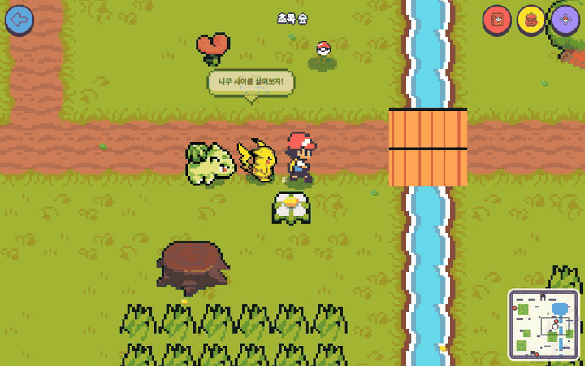
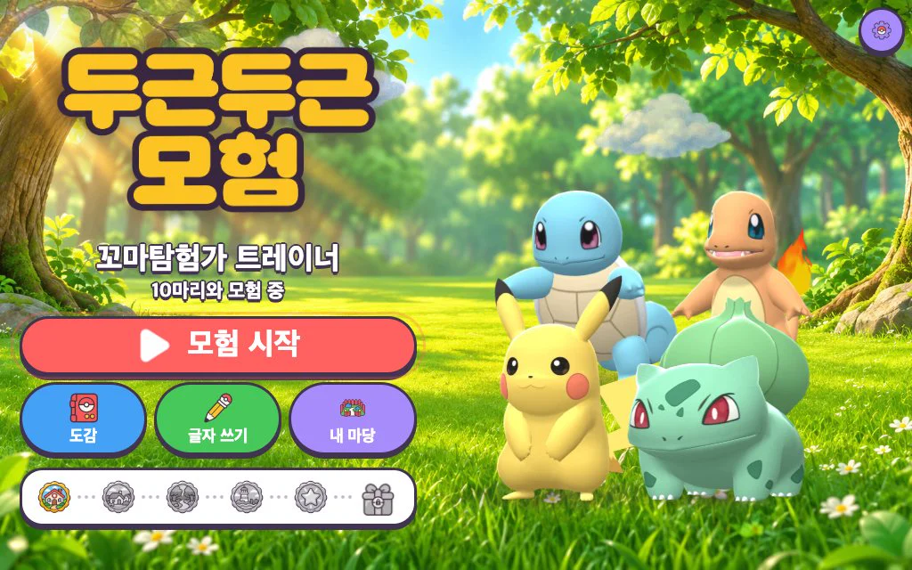
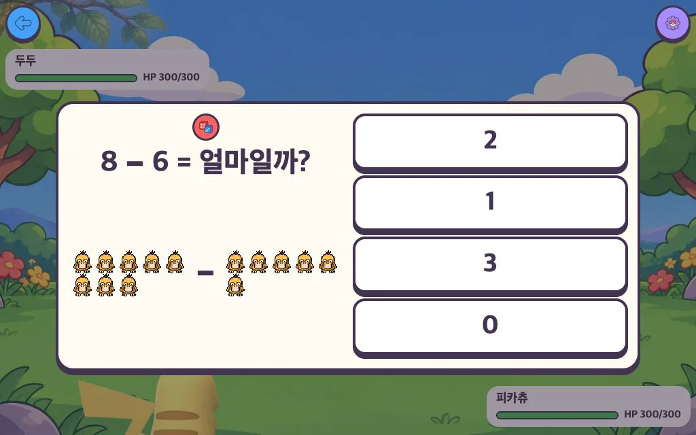
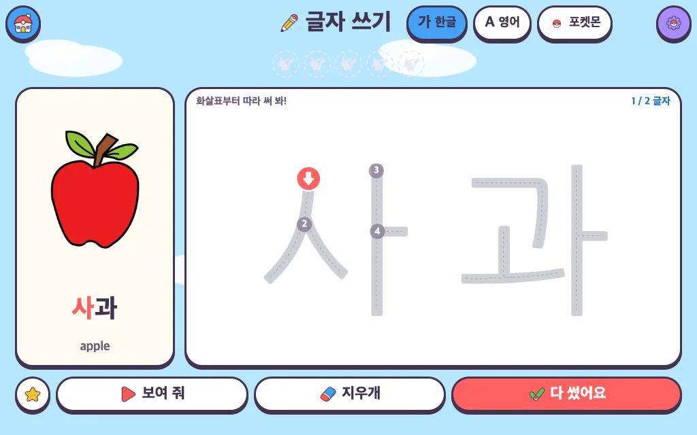
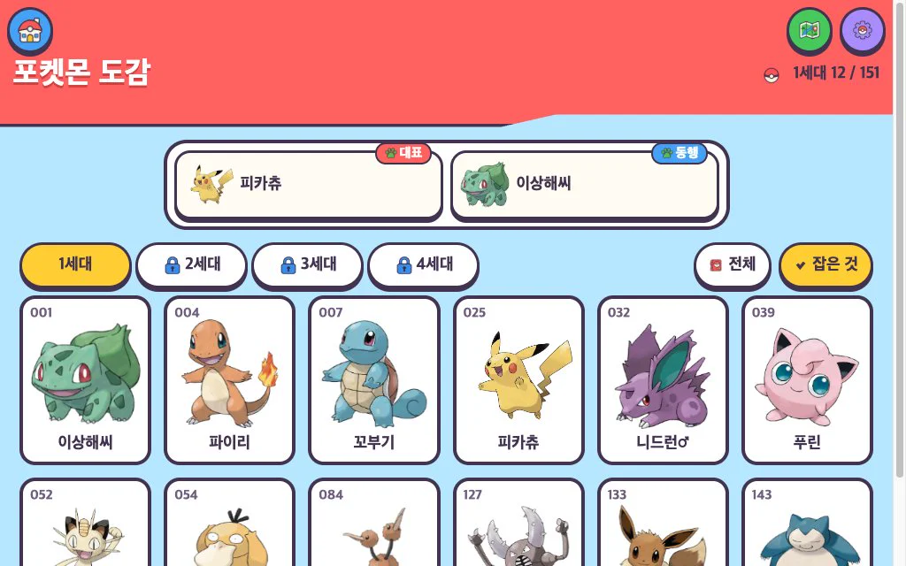
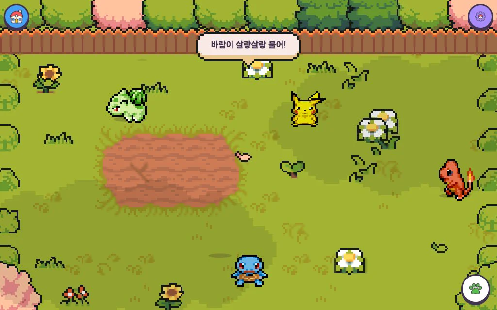
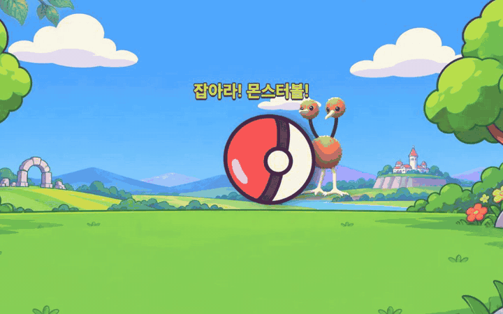
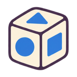

<div align="center">


# PokeAdventure

### 문제를 풀고, 포켓몬을 모으며 떠나는 첫 모험

**수학 · 한글 · 영어 · 창의력**을 탐험하는 5~7세 어린이 게임

[**지금 모험 시작하기**](https://pokemon-quiz-bay.vercel.app/)　·　[게임 둘러보기](#게임-둘러보기)　·　[아이와 시작하기](#아이와-시작하기)　·　[제안하기](https://github.com/semi0x3b/PokeAdventure/issues/new/choose)



<sub>실제 게임 화면 · 소개용 시험 수첩 촬영 · GIF는 플레이 일부를 짧게 편집했습니다.</sub>

</div>

## 오늘은 어떤 친구를 만날까?

숲길을 걷다가 발견한 몬스터볼. 가까이 가면 **그림자 속 포켓몬**이 나타나요.
누구인지 맞히고, 함께 문제를 풀어 보세요. 몬스터볼이 흔들리다 찰칵! 새로운 친구가 도감에 찾아옵니다.

**지역 고르기 → 필드 탐험 → 그림자 맞히기 → 학습 문제 → 포획과 도감 등록**

혼자 정답만 고르는 연습을 넘어, 걷고 만나고 모으는 모험으로 이어집니다.

## 게임 둘러보기

<table>
<tr>
<td width="50%" valign="top">

<h3>함께 떠나는 모험</h3>
숲·도시·사막·바다를 골라 화면을 눌러 걸어요. 잡은 포켓몬 두 마리가 트레이너 뒤를 따라다녀요. **50마리를 모으면 세 마리**와 함께 다닐 수 있어요. 지역마다 만날 친구도 달라집니다.
</td>
<td width="50%" valign="top">

<h3>문제를 풀면 다음 장면으로</h3>
그림자 퀴즈와 학습 문제가 배틀 속에서 이어져요. 금색 몬스터볼에서는 더 긴 퀴즈와 특별한 만남을 기대해 보세요.
</td>
</tr>
<tr>
<td width="50%" valign="top">

<h3>손가락으로 따라 쓰기</h3>
그림을 보고 낱말을 익힌 뒤, 움직이는 화살표를 따라 한글·영어·포켓몬 이름을 써요. 쓰기를 마치면 도장과 선물이 기다려요.
</td>
<td width="50%" valign="top">

<h3>한 칸씩 채워 가는 도감</h3>
잡은 친구의 모습과 이름을 모으고 대표·동행 포켓몬을 골라요. 아직 못 만난 친구를 누르면 어느 지역에서 찾을지 힌트도 볼 수 있어요.
</td>
</tr>
</table>

### 모험을 마치면, 내 마당에서

<div align="center">

</div>

공룡·로봇·자동차·인형 등 **15가지 테마 마당**을 모아요. 마당마다 좋아하는 친구를 최대 **10마리**까지 풀어 두고 쓰다듬어요. 10마리를 잡으면 눈의 마을이 열리고, 그 뒤 10마리마다 받는 열쇠로 원하는 마을을 골라 열어요. 매일 받는 출석 도장도 모아 보세요. **도장 다섯 개마다 선물**을 열 수 있습니다. 도장을 받으면 오늘 기분 스티커(기쁨·슬픔·편안함·화남)도 골라 붙여요. 지난 날 스티커는 달력에 그대로 남아요.

### 덜컥… 덜컥… 찰칵!

<div align="center">

</div>

맞힌 문제의 끝에는 새로운 만남이 기다려요. 잡은 친구를 도감에서 확인하고 다음 모험에 데려가 보세요.

## 배우는 것도 네 가지

| | 영역 | 이런 문제를 만나요 |
| --- | --- | --- |
|  | **수학** | 그림으로 수 세기, 100까지 덧셈·뺄셈 |
|  | **한글** | 글자·받침·낱말·짧은 문장 |
|  | **영어** | 알파벳·기초 단어·짧은 표현 |
|  | **창의력** | 분류·순서·상황 판단·수수께끼 |

**5천여 개 문제**에서 무작위로 출제합니다. 아이에게 맞게 영역과 단계를 고르고, 브라우저의 읽어 주기를 켜거나 끌 수 있어요.

## 아이와 시작하기

1. **[게임 주소](https://pokemon-quiz-bay.vercel.app/)를 열어요.** 부모가 처음 한 번 별명과 숫자 4자리 비밀번호로 모험 수첩을 만듭니다.
2. **첫 친구 피카츄를 만나요.** 처음 안내를 따라가거나, 건너뛰어 피카츄와 바로 모험을 시작할 수 있어요.
3. **지역을 골라 걸어 보세요.** 터치·클릭한 곳으로 이동해요. PC에서는 방향키·WASD와 보기 선택 1~4 키도 사용할 수 있습니다.

아이폰·아이패드는 **Safari → 공유 → 홈 화면에 추가**로 앱처럼 열 수 있습니다. 다른 기기에서는 브라우저의 설치·홈 화면 추가 메뉴를 확인하세요. 따로 설치하지 않고 브라우저에서 바로 해도 됩니다.

<details>
<summary><b>부모님이 알아둘 것: 잠금·저장·기기 변경</b></summary>

- 새로 열기·새로고침·30분 미사용 뒤에는 부모 비밀번호로 다시 엽니다. 잠깐 다른 앱에 다녀와도 이어 할 수 있고, 로그인 이름은 기본으로 기억합니다. 이 잠금은 아이의 실행을 줄이는 장치이며 기기 잠금이나 스크린 타임을 대신하지 않습니다.
- 기록은 **현재 기기의 브라우저에 저장**합니다. 같은 이름으로 다른 기기에서 열어도 자동으로 이어지지 않습니다.
- 기기를 바꾸기 전 설정에서 **기록 백업**을 받고 새 기기에서 **기록 복원**을 사용하세요. 백업에는 진행만 들어가고 별명·비밀번호·확인값은 들어가지 않습니다. 백업 파일도 공개하지 마세요.
- 브라우저 데이터 삭제·기기 분실에 대비해 백업을 보관하세요. 기존 버전의 기기 캐시가 있으면 첫 수첩을 만들 때 이전과 같은 이름을 사용합니다.
- 처음 받는 그림·소리에는 인터넷 연결이 필요합니다. 읽어 주기는 기기 설정에 따라 외부 음성 제공자가 처리할 수 있습니다.
- 실제 iPad Safari의 홈 화면 설치·손가락 입력·울음소리 재생은 기기에서 추가 확인이 필요합니다.

[개인정보·보관 안내](https://pokemon-quiz-bay.vercel.app/privacy.html) · [이용 조건](https://pokemon-quiz-bay.vercel.app/terms.html)

</details>

## 같이 더 재미있게 만들어요

아이와 해 보며 불편했던 순간, 새로 만나고 싶은 기능을 알려 주세요.

**[기능 제안](https://github.com/semi0x3b/PokeAdventure/issues/new?template=feature.yml)** · **[오류 제보](https://github.com/semi0x3b/PokeAdventure/issues/new?template=bug.yml)** · [기여 안내](CONTRIBUTING.md)

제보는 **부모님이 작성하는 공개 게시판**입니다. 아이 이름·얼굴·연락처·비밀번호·백업은 올리지 마세요. 게임 기록은 자동 첨부하지 않습니다. 보안 문제는 [비공개 신고](https://github.com/semi0x3b/PokeAdventure/security/advisories/new)로 받습니다.

화면을 바꾸는 PR은 **같은 조건의 전후 이미지**와 실제 확인 결과를 함께 남깁니다. [PR 템플릿](.github/PULL_REQUEST_TEMPLATE.md)에서 시작하세요.

<details>
<summary><b>직접 실행하고 개발하기</b></summary>

Node.js 22 이상. HTML·CSS·일반 JavaScript로 만들었으며 별도 패키지 설치 없이 실행합니다.

```sh
npm start
```

터미널에 표시되는 로컬 주소를 엽니다. 기본 주소는 `http://127.0.0.1:4173`입니다.

| 명령 | 하는 일 |
| --- | --- |
| `npm test` | 게임 규칙·저장·잠금 등 자동 검사 |
| `npm run validate` | 문제의 보기 개수·중복·정답 검사 |
| `npm run build` | Vercel 배포용 `dist` 만들기 |

서버 계정·데이터베이스 설정은 필요하지 않습니다. 옛 `/api/game` 요청은410으로 종료합니다. 구글 계정 연결은 후속 기획이며 현재 기능이 아닙니다.

</details>

## 만든 자료와 빌려온 자료

이 게임은 **비공식·비상업 포켓몬 팬 프로젝트**입니다. Nintendo, Creatures, GAME FREAK, The Pokémon Company의 공식 제품이나 승인·제휴를 주장하지 않습니다. Pokémon 이름·캐릭터·이미지·울음소리의 권리는 각 권리자에게 있습니다. 무료 제공·API 이용·출처 표기가 별도 사용 허가를 뜻하지는 않습니다.

실행용 원작 그림·도트·울음소리 개별 파일은 저장소와 배포물에 묶지 않고 [PokeAPI](https://pokeapi.co/), [SpriteCollab](https://github.com/PMDCollab/SpriteCollab) 등 외부 자료원에서 불러옵니다. 원본 연결 실패 때는 같은 공개 파일의 jsDelivr CDN 주소를 사용합니다. 울음소리는 실제 음원 형식에 맞춰 재생하며 실패하면 PokeAPI의 종 이름을 확인해 Pokémon Showdown MP3를 사용합니다. 이름·타입·능력치와 프레임 정보는 게임용 JS 데이터에 포함되어 있습니다. 문서의 화면·GIF는 기능을 소개하기 위한 게임 캡처입니다.

| 자료 | 출처와 조건 |
| --- | --- |
| 학습 그림 | Sergio Palao / Gobierno de Aragón, [ARASAAC](https://arasaac.org/), CC BY-NC-SA 4.0 |
| 사막 선인장 타일 | [Kenney Roguelike/RPG pack](https://kenney.nl/assets/roguelike-rpg-pack), CC0 |
| 필드·마당 타일과 음악 | Pixel-boy / AAA, [Ninja Adventure](https://pixel-boy.itch.io/ninja-adventure-asset-pack), CC0 |
| 따라 쓰기 글꼴 | Nanum Gothic·Andika, SIL OFL 1.1. [글꼴 문서](img/fonts/README.md) |
| 동행 도트 | [개별 작가·출처·조건](docs/field-sprites/CREDITS.md). 라이선스 미지정 자료를 자유 사용으로 바꾸어 설명하지 않습니다. |

**[MIT](LICENSE)는 직접 작성한 코드에만 적용**합니다. 제삼자의 캐릭터·상표·그림·음원·폰트·데이터에는 각 자료의 조건이 적용됩니다. 게임 설정의 **그림·소리 출처**에서도 확인할 수 있습니다.
