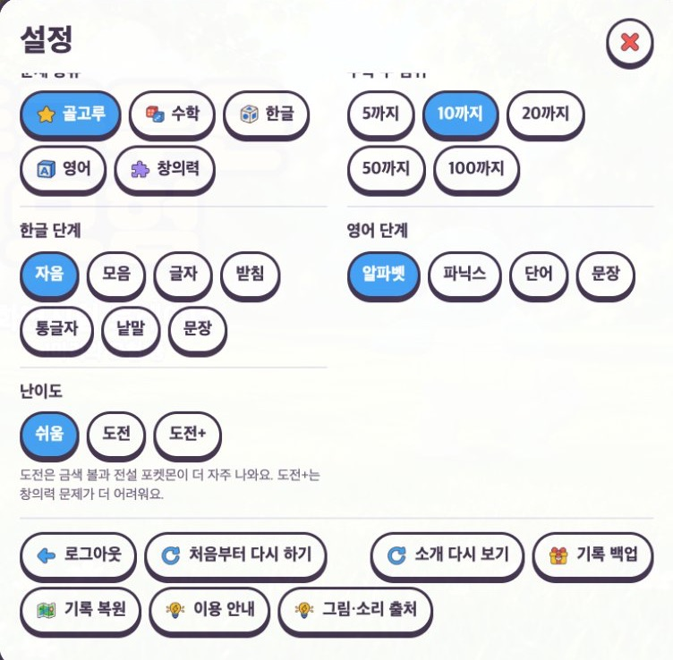
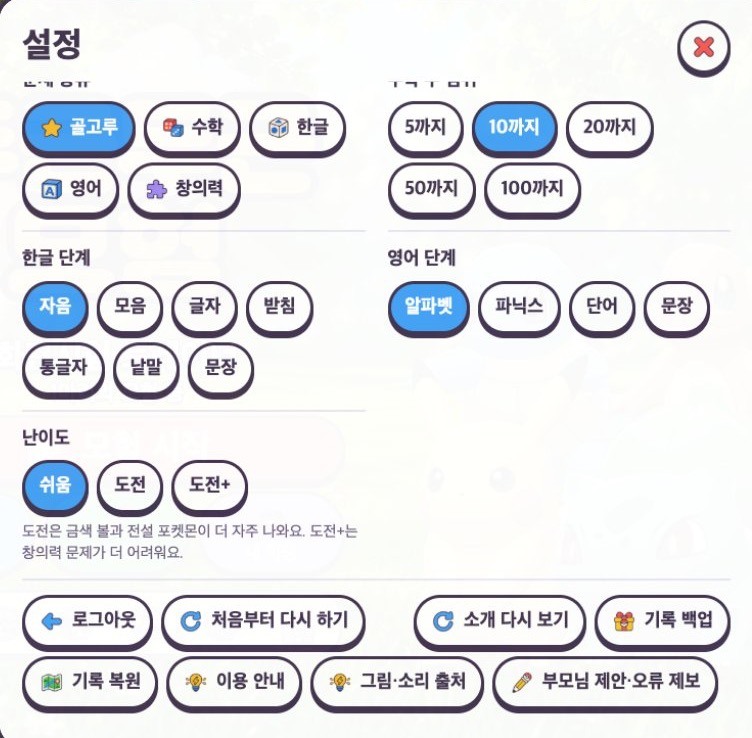
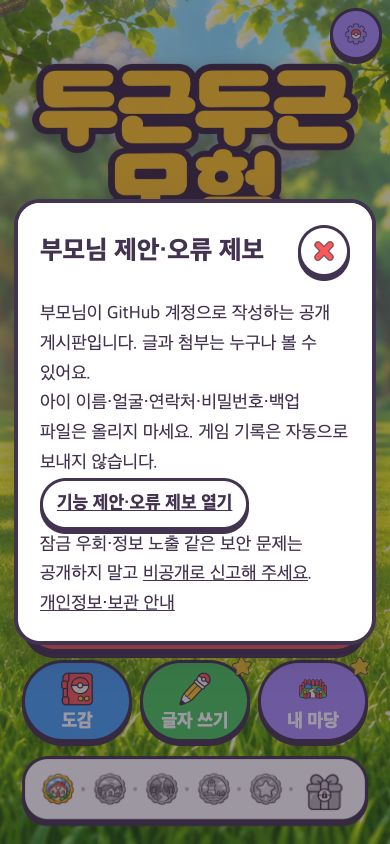

# 부모용 제보 창구 화면 확인

2026-11-18, Aside 실제 화면. 설정 전후는 모두 1024×768·시험용 수첩·같은 학습 설정·하단으로 스크롤한 상태다. 개인정보와 실제 사용자 기록을 넣지 않았다. 신규 제보 창은 390×844다.

| 설정 변경 전 | 설정 변경 후 |
| --- | --- |
|  |  |

새 제보 창(기존 화면 없음):

확인: 부모 잠금 → 시험 수첩 열기 → 설정 → 제안/오류 안내, 고정 GitHub 링크(개인 기록/query 없음), 390×844·734×343·1024×768 범위/가로 넘침, 마지막 링크에서 Tab → 닫기/ESC, 개별 도트 크레딧, 잠금 없이 접근 가능한 개인정보 문서. 게임기록 API 요청은0이었다. 공개 이슈를 실제 제출하지 않았다.

검사: npm test104개 통과, npm run validate 통과, npm run build 통과. 캡처/시험 원본은 .test/public-review/. 실제 iPhone/iPad Safari에서는 미검증이다.
