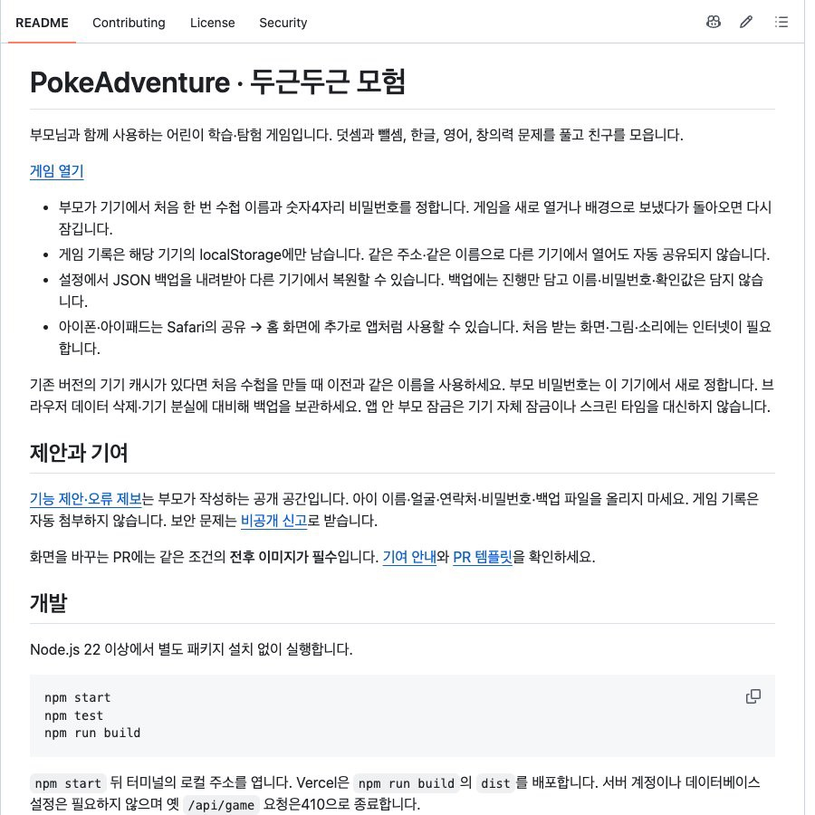
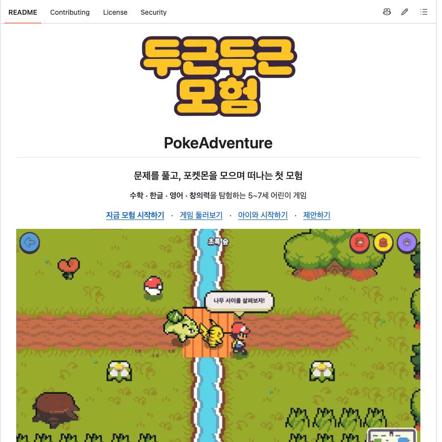

# README 전후 확인

GitHub 실제 렌더링, 1280×900 창에서 README 시작 부분을 같은 위치에 놓고 문서 열만 잘랐습니다. 이전은 main92db774, 변경 후는 문서 작업 브랜치입니다.

| 변경 전 | 변경 후 |
| --- | --- |
|  |  |

확인: 문서 이미지14개(애니메이션의 GitHub 대체 이미지 포함) 로딩, 내부 투어 링크, 414px 세로 화면의 문서 가로 넘침, 실제 UI·걷기/포획 연속 캡처. 시험 수첩을 사용했습니다. 앱 코드와 배포 설정은 바꾸지 않았으므로 앱 재배포는 하지 않습니다. 문제 수량은 기존 검사기로5285개를 확인했습니다. 문서 변경을 위해 형식적인 게임 테스트를 추가하거나 재실행하지 않았습니다.

원본·추가 캡처·결과는 .test/readme-showcase/에 있습니다.
